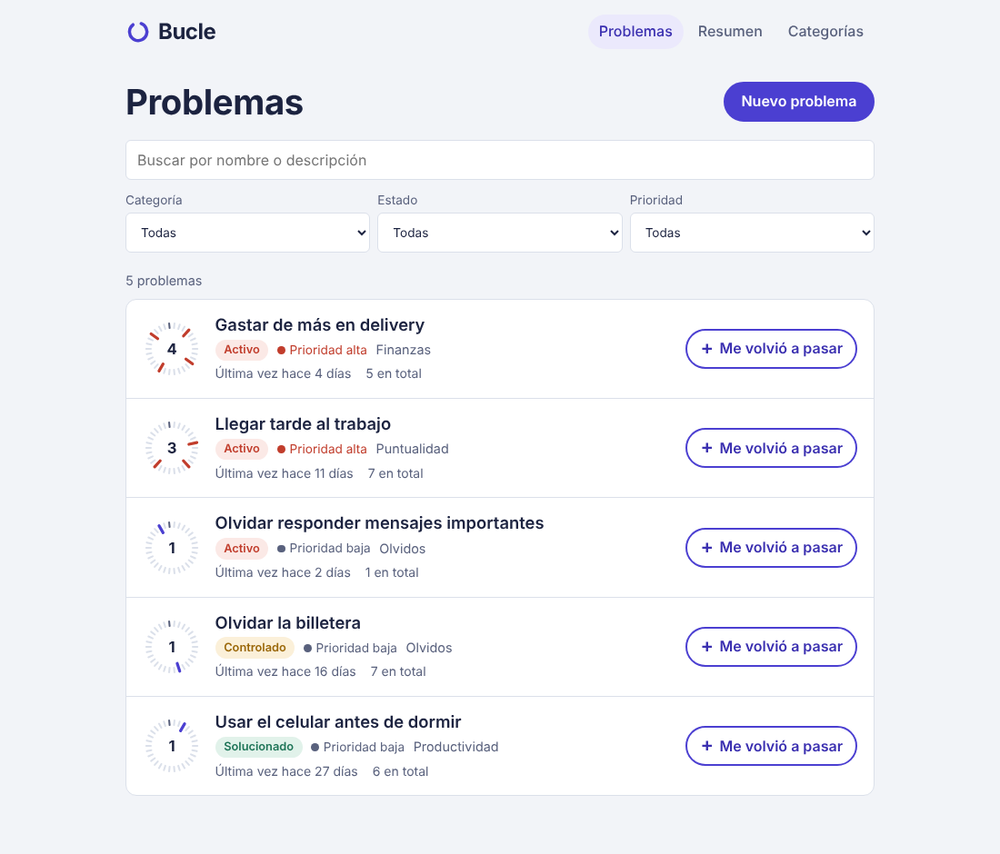
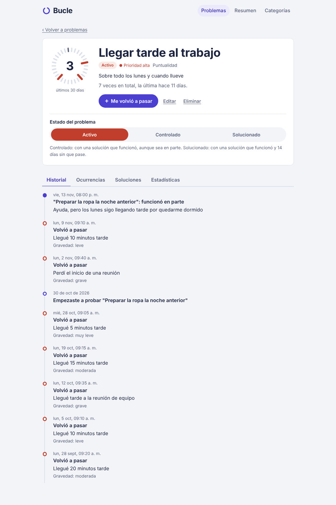
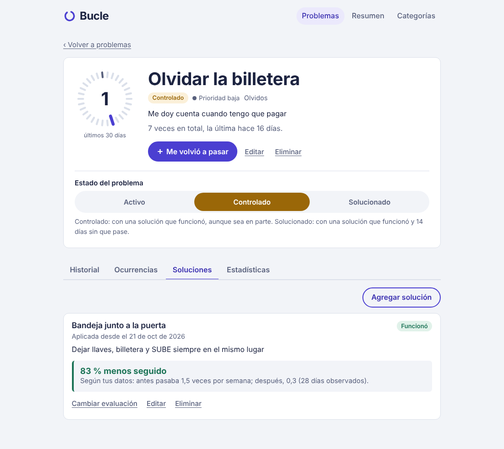
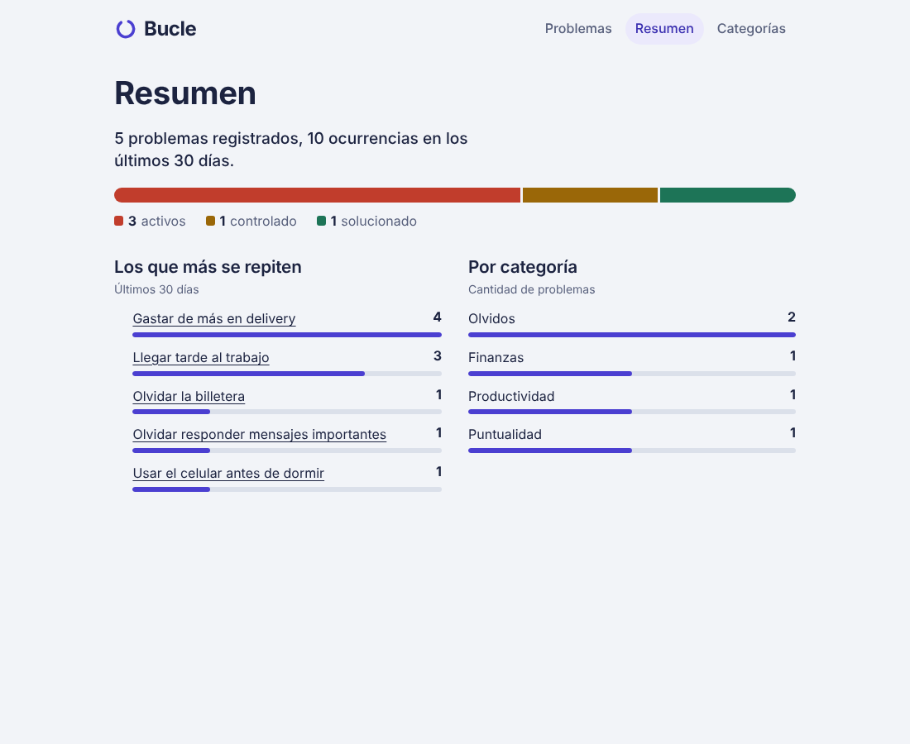

# Bucle

Aplicación web para registrar **problemas que se repiten** (llegar tarde, olvidarse algo, gastar de más), anotar cada vez que vuelven a pasar y documentar las **soluciones** que se prueban. Con esos datos, Bucle calcula la frecuencia, detecta patrones (qué día y en qué momento pasa más) y **compara la frecuencia antes y después de cada solución** para mostrar cuáles funcionan de verdad.

> Proyecto final propio — Generación T.

## Enlaces

| | |
|---|---|
| Aplicación | **https://erroresapp.netlify.app** |
| API | https://bucle.onrender.com/api/salud |
| Repositorio | https://github.com/FacuScardaoni/bucle |

> La API está en el plan gratuito de Render: si estuvo un rato sin uso, la primera carga puede tardar hasta un minuto. La aplicación lo avisa con "Conectando con el servidor…".

## Capturas

| Problemas | Detalle: historial |
|---|---|
|  |  |

| Soluciones con efectividad | Resumen |
|---|---|
|  |  |

Más capturas: [estadísticas](docs/capturas/estadisticas.png) · [celular](docs/capturas/movil.png) · [regla de estado rechazada](docs/capturas/estado-rechazado.png) · [validación de formulario](docs/capturas/validacion-formulario.png).

## Qué se puede hacer

- Crear, editar y eliminar **categorías** y **problemas**.
- Registrar cada **ocurrencia** con fecha, descripción, contexto, posible causa y gravedad (botón "Me volvió a pasar").
- Registrar **soluciones**, evaluarlas (funcionó, en parte, no funcionó) y ver la **efectividad según los datos**.
- Cambiar el **estado** (Activo, Controlado, Solucionado) con condiciones de negocio.
- **Buscar** y **filtrar** por categoría, estado y prioridad (calculada automáticamente).
- Ver el **historial** cronológico, las **estadísticas** de cada problema y un **resumen** general.

## Reglas de negocio

La especificación completa está en [`docs/SPEC.md`](docs/SPEC.md): 10 funcionalidades y **22 reglas numeradas** (RN-01 a RN-22). Algunos ejemplos:

- **RN-08:** la prioridad se calcula con las ocurrencias de los últimos 30 días y sube un nivel si alguna fue grave.
- **RN-10:** si un problema solucionado vuelve a pasar, se reactiva solo y queda registrado como recaída.
- **RN-15:** para marcar un problema como solucionado hace falta una solución que funcionó y 14 días sin que pase.
- **RN-20:** la efectividad compara cuántas veces por semana pasaba antes y después de aplicar cada solución.

## Tecnología

| Capa | Tecnología | Publicado en |
|---|---|---|
| Frontend | HTML, CSS y JavaScript sin frameworks | Netlify |
| Backend | Node.js 22 + Express 5 (API REST) | Render |
| Base de datos | PostgreSQL | Neon |
| Tests | `node:test` + `supertest` | — |

Arquitectura del backend: rutas → servicios → dominio (reglas de negocio como funciones puras) y repositorios con dos implementaciones intercambiables (PostgreSQL para producción, memoria para los tests). Detalles en [`AGENTS.md`](AGENTS.md).

## Correr el proyecto en tu computadora

Requisitos: Node.js 22 o superior.

```bash
git clone https://github.com/FacuScardaoni/bucle.git
cd bucle/backend
npm install
npm run dev            # API en http://localhost:3000 (sin DATABASE_URL usa datos en memoria)
```

En otra terminal, servir el frontend (detecta solo que está en local y usa la API de `localhost:3000`):

```bash
cd bucle
npx serve frontend     # o cualquier servidor estático
```

Para usar PostgreSQL, copiar `backend/.env.example` como `backend/.env`, completar `DATABASE_URL` y, opcionalmente, cargar los datos de demostración con `npm run seed`.

## Pruebas

```bash
cd backend
npm test               # 109 tests, sin base de datos
npm run test:db        # 14 tests contra una base PostgreSQL de prueba (DATABASE_URL_TEST)
```

Resultados, cobertura por regla, pruebas manuales y prueba en producción: [`docs/INFORME_PRUEBAS.md`](docs/INFORME_PRUEBAS.md).

## Publicación

| Servicio | Configuración |
|---|---|
| **Neon** | Proyecto PostgreSQL. Las tablas las crea el servidor al arrancar (`backend/db/schema.sql`). Datos de demostración: pegar `backend/db/seed.sql` en el SQL Editor una vez. |
| **Render** | Web Service, Root Directory `backend`, Build `npm install`, Start `npm start`. Variables: `DATABASE_URL` (Neon), `CORS_ORIGIN` (dirección de Netlify), `NODE_VERSION=22`. |
| **Netlify** | Carpeta `frontend`, sin paso de compilación (`frontend/netlify.toml`). La dirección de la API está en `frontend/js/config.js`. |

Ningún secreto está en el repositorio: la cadena de conexión vive solo en las variables de entorno de Render.

## Documentación

- [`docs/SPEC.md`](docs/SPEC.md): especificación, modelo de datos, reglas de negocio y API.
- [`docs/PLAN.md`](docs/PLAN.md): plan de 21 tareas (una por commit) y decisiones tomadas.
- [`docs/INFORME_PRUEBAS.md`](docs/INFORME_PRUEBAS.md): informe de pruebas.
- [`AGENTS.md`](AGENTS.md): instrucciones para agentes de IA.

## Limitaciones conocidas

- Versión de un solo usuario, sin inicio de sesión: cualquiera con el enlace puede ver y modificar los datos.
- La primera carga puede tardar por el plan gratuito de Render.

## Estructura

```
bucle/
├── AGENTS.md · README.md
├── docs/        SPEC.md · PLAN.md · INFORME_PRUEBAS.md · capturas/
├── backend/     src/ (dominio, servicios, repositorios, rutas) · db/ · test/
└── frontend/    index.html · css/ · js/ (api, ui, formularios, vistas/) · netlify.toml
```
