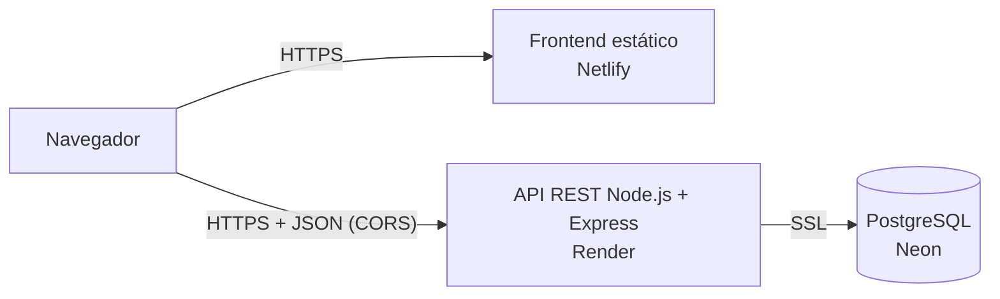

# Manual técnico — Bucle

Guía para instalar, entender, probar, publicar y mantener Bucle. Está dirigida a desarrolladores y a docentes que quieran revisar el código.

## Índice

1. [Arquitectura](#1-arquitectura)
2. [Estructura del repositorio](#2-estructura-del-repositorio)
3. [Instalación local](#3-instalación-local)
4. [Variables de entorno](#4-variables-de-entorno)
5. [Base de datos](#5-base-de-datos)
6. [Backend: capas y responsabilidades](#6-backend-capas-y-responsabilidades)
7. [Referencia de la API](#7-referencia-de-la-api)
8. [Frontend](#8-frontend)
9. [Pruebas](#9-pruebas)
10. [Publicación (deploy)](#10-publicación-deploy)
11. [Mantenimiento](#11-mantenimiento)
12. [Solución de problemas](#12-solución-de-problemas)
13. [Cómo agregar o cambiar una regla de negocio](#13-cómo-agregar-o-cambiar-una-regla-de-negocio)

---

## 1. Arquitectura



| Componente | Tecnología | Publicado en | Dirección |
|---|---|---|---|
| Frontend | HTML, CSS y JavaScript (módulos ES, sin frameworks ni compilación) | Netlify | https://erroresapp.netlify.app |
| Backend | Node.js 22, Express 5 | Render (Web Service gratuito) | https://bucle.onrender.com/api |
| Base de datos | PostgreSQL | Neon (región São Paulo) | Privada (variable `DATABASE_URL`) |

Dependencias del backend: `express`, `pg`, `cors` (producción) y `supertest` (desarrollo). El frontend no tiene dependencias; solo carga dos tipografías de Google Fonts.

## 2. Estructura del repositorio

```
bucle/
├── README.md                 presentación, enlaces e instrucciones rápidas
├── AGENTS.md                 instrucciones para agentes de IA
├── docs/
│   ├── SPEC.md               especificación: funcionalidades, reglas RN-01 a RN-22, API
│   ├── PLAN.md               tareas (una por commit) y decisiones D-01 en adelante
│   ├── RELEVAMIENTO.md       relevamiento y análisis
│   ├── MANUAL_USUARIO.md     manual de usuario
│   ├── MANUAL_TECNICO.md     este documento
│   ├── INFORME_PRUEBAS.md    informe de pruebas
│   └── capturas/             imágenes de la interfaz
├── backend/
│   ├── package.json
│   ├── .env.example          variables de entorno de ejemplo (sin valores reales)
│   ├── db/
│   │   ├── schema.sql        tablas (idempotente, se ejecuta al arrancar)
│   │   └── seed.sql          datos de demostración
│   ├── src/
│   │   ├── server.js         arranque: elige repositorios, conecta la base, abre el puerto
│   │   ├── app.js            arma Express (rutas, CORS, JSON, errores)
│   │   ├── dominio/          reglas de negocio (funciones puras)
│   │   ├── servicios/        casos de uso
│   │   ├── repositorios/     memoria/ y postgres/
│   │   ├── rutas/            endpoints HTTP
│   │   └── scripts/seed.js   carga de datos de demostración
│   └── test/                 dominio/, api/, repositorios/
└── frontend/
    ├── index.html
    ├── netlify.toml
    ├── img/icono.svg
    ├── css/estilos.css
    └── js/
        ├── config.js         dirección de la API
        ├── api.js            cliente HTTP y errores
        ├── ui.js             creación de elementos, formatos, diálogos, anillo
        ├── formularios.js    formularios de alta y edición
        ├── app.js            navegación por "#"
        └── vistas/           listado, detalle, categorías, resumen
```

## 3. Instalación local

**Requisitos:** Node.js 22 o superior y Git. PostgreSQL es opcional (sin base, la API usa datos en memoria).

```bash
git clone https://github.com/FacuScardaoni/bucle.git
cd bucle/backend
npm install
npm run dev                 # API en http://localhost:3000, se reinicia sola al guardar cambios
```

Frontend, en otra terminal:

```bash
cd bucle
npx serve frontend          # o: python3 -m http.server 8080 --directory frontend
```

`frontend/js/config.js` detecta si la página se abre desde `localhost` y en ese caso usa la API local (`http://localhost:3000/api`); si no, usa la de Render.

**Con PostgreSQL local:**

```bash
cd backend
cp .env.example .env        # completar DATABASE_URL
npm run seed                # opcional: datos de demostración (solo si la base está vacía)
npm run dev
```

## 4. Variables de entorno

| Variable | Dónde | Obligatoria | Descripción |
|---|---|---|---|
| `DATABASE_URL` | Render / `.env` | En producción | Connection string de PostgreSQL. Si falta, la API usa memoria (los datos se pierden al reiniciar). |
| `PORT` | Render (automática) / `.env` | No | Puerto HTTP. Por defecto 3000. |
| `CORS_ORIGIN` | Render / `.env` | Recomendada | Origen permitido para el navegador. En producción: `https://erroresapp.netlify.app`. Admite varios separados por coma. Por defecto `*`. |
| `NODE_VERSION` | Render | Sí en Render | `22`. |
| `DATABASE_URL_TEST` | `.env` | Solo para `npm run test:db` | Base de **prueba**: se vacía en cada ejecución. |

El archivo `.env` está en `.gitignore` y **nunca** se sube al repositorio.

## 5. Base de datos

El esquema está en [`backend/db/schema.sql`](../backend/db/schema.sql). Es idempotente (`CREATE TABLE IF NOT EXISTS`) y el servidor lo ejecuta en cada arranque, así que no hay migraciones manuales.

| Tabla | Contenido | Restricciones principales |
|---|---|---|
| `categorias` | id, nombre, nombre_normalizado, descripcion | `nombre_normalizado` único (RN-02) |
| `problemas` | id, nombre, nombre_normalizado, descripcion, categoria_id, estado, fecha_creacion, fecha_estado | `nombre_normalizado` único (RN-04); FK a categorías `ON DELETE RESTRICT` (RN-03); `CHECK` de estado |
| `ocurrencias` | id, problema_id, fecha, descripcion, contexto, posible_causa, gravedad | FK `ON DELETE CASCADE` (RN-18); `CHECK gravedad BETWEEN 1 AND 5` |
| `soluciones` | id, problema_id, nombre, nombre_normalizado, descripcion, fecha_aplicacion, resultado, observaciones, fecha_evaluacion | `UNIQUE (problema_id, nombre_normalizado)` (RN-11); FK `ON DELETE CASCADE`; `CHECK` de resultado |
| `cambios_estado` | id, problema_id, estado_anterior, estado_nuevo, motivo, fecha | FK `ON DELETE CASCADE`; `CHECK` de motivo |

Notas:

- **`nombre_normalizado`:** el nombre sin mayúsculas, sin acentos y con espacios simples. Permite detectar "Educación" = "EDUCACION".
- **Valores calculados:** cantidad de ocurrencias, última ocurrencia, prioridad, actividad de 30 días, estadísticas y efectividad **no se guardan**; se calculan en cada consulta (RN-07).
- **Fechas:** `TIMESTAMPTZ` para fecha y hora (se guardan en UTC); `DATE` para la fecha de aplicación de una solución, interpretada en hora de Argentina.
- **Conexión:** si la base no es local, el servidor fuerza SSL (Neon lo exige).

Diagrama entidad-relación: ver [relevamiento, sección 10](RELEVAMIENTO.md#10-modelo-de-datos).

## 6. Backend: capas y responsabilidades

```
rutas/  ──►  servicios/  ──►  dominio/          (reglas puras: sin base de datos ni HTTP)
                 │
                 └──►  repositorios/  ──►  postgres/  (producción)
                                       └──►  memoria/   (tests y desarrollo sin base)
```

| Capa | Archivos | Responsabilidad |
|---|---|---|
| **Dominio** | `enums.js`, `errores.js`, `validaciones.js`, `fechas.js`, `reloj.js`, `categoria.js`, `problema.js`, `ocurrencia.js`, `solucion.js`, `estados.js`, `busqueda.js`, `historial.js`, `estadisticas.js` | Validaciones y reglas de negocio. Cada regla está en un solo lugar y se cita con su código (RN-xx). |
| **Servicios** | `categorias.js`, `problemas.js`, `ocurrencias.js`, `soluciones.js`, `consultas.js`, `index.js` | Coordinan cada caso de uso: obtienen datos, aplican el dominio, guardan (con transacción cuando hace falta). |
| **Repositorios** | `memoria/index.js`, `postgres/index.js` | Solo leen y guardan. Misma interfaz: `listar(filtro)`, `obtener(id)`, `crear(datos)`, `actualizar(id, cambios)`, `eliminar(id)` y `transaccion(operacion)`. |
| **Rutas** | `categorias.js`, `problemas.js`, `ocurrencias.js`, `soluciones.js`, `consultas.js`, `errores.js` | Traducen HTTP a llamadas de servicio y errores a respuestas JSON. |

Decisiones de diseño importantes:

- **Reloj inyectable:** la hora actual sale de un objeto `reloj`. En los tests se usa un reloj fijo, así los cálculos de "últimos 30 días" o "14 días" dan siempre lo mismo.
- **Cálculos en JavaScript:** con un solo usuario y pocos datos, filtros y estadísticas se calculan en el dominio y no con SQL complejo. La misma lógica sirve para memoria y PostgreSQL.
- **Transacciones:** registrar una ocurrencia que provoca una recaída guarda la ocurrencia y el cambio de estado juntos (RN-10).

Todas las decisiones están registradas en la sección "Decisiones" de [`PLAN.md`](PLAN.md).

## 7. Referencia de la API

Base: `https://bucle.onrender.com/api` (local: `http://localhost:3000/api`). Todo es JSON.

### 7.1 Endpoints

| Método | Ruta | Descripción | Respuesta OK |
|---|---|---|---|
| GET | `/salud` | Estado del servicio | 200 |
| GET | `/categorias` | Lista (con `cantidadProblemas`) | 200 |
| POST | `/categorias` | Crea: `{ nombre, descripcion? }` | 201 |
| GET · PUT · DELETE | `/categorias/:id` | Consulta, edita, elimina (RN-03) | 200 · 200 · 204 |
| GET | `/problemas?q=&categoria=&estado=&prioridad=` | Lista filtrada y ordenada (RN-19) | 200 |
| POST | `/problemas` | Crea: `{ nombre, categoriaId, descripcion? }` | 201 |
| GET · PUT | `/problemas/:id` | Detalle con valores calculados · edita | 200 |
| DELETE | `/problemas/:id?confirmar=true` | Elimina (RN-18) | 204 |
| PATCH | `/problemas/:id/estado` | `{ estado }` (RN-14 a RN-16) | 200 |
| GET · POST | `/problemas/:id/ocurrencias` | Lista · crea `{ fecha, descripcion, gravedad, contexto?, posibleCausa? }` | 200 · 201 |
| PUT · DELETE | `/ocurrencias/:id` | Edita · elimina | 200 · 204 |
| GET · POST | `/problemas/:id/soluciones` | Lista con `efectividad` · crea `{ nombre, fechaAplicacion, descripcion? }` | 200 · 201 |
| PUT · DELETE | `/soluciones/:id` | Edita · elimina (RN-17) | 200 · 204 |
| PATCH | `/soluciones/:id/evaluacion` | `{ resultado, observaciones? }` (RN-13) | 200 |
| GET | `/problemas/:id/historial` | Línea de tiempo (RN-22) | 200 |
| GET | `/problemas/:id/estadisticas` | Estadísticas del problema (RN-21) | 200 |
| GET | `/estadisticas` | Resumen general (RN-21) | 200 |

Formatos: fecha y hora en ISO 8601 (`2026-11-20T09:30:00-03:00`); fecha de calendario `AAAA-MM-DD`; los enteros se aceptan como número o texto.

### 7.2 Ejemplos

**Detalle de un problema** — `GET /api/problemas/2`

```json
{
  "id": 2,
  "nombre": "Olvidar la billetera",
  "descripcion": "Me doy cuenta cuando tengo que pagar",
  "categoriaId": 2,
  "estado": "CONTROLADO",
  "fechaCreacion": "2026-09-21T03:00:00.000Z",
  "fechaEstado": "2026-11-16T00:00:00.000Z",
  "categoriaNombre": "Olvidos",
  "cantidadOcurrencias": 7,
  "fechaUltimaOcurrencia": "2026-11-04T11:40:00.000Z",
  "prioridad": "BAJA",
  "actividad30Dias": [0, 0, 0, 0, 0, 0, 0, 0, 0, 0, 0, 0, 0, 0, 0, 0, 1, 0, 0, 0, 0, 0, 0, 0, 0, 0, 0, 0, 0, 0]
}
```

`actividad30Dias` tiene 30 valores: la cantidad de ocurrencias de cada día, empezando por hoy (índice 0). La interfaz lo usa para dibujar el anillo.

**Solución con efectividad** — `GET /api/problemas/2/soluciones`

```json
[{
  "id": 2, "problemaId": 2, "nombre": "Bandeja junto a la puerta",
  "fechaAplicacion": "2026-10-21", "resultado": "FUNCIONO", "observaciones": null,
  "fechaEvaluacion": "2026-11-14T23:00:00.000Z",
  "efectividad": {
    "estado": "CALCULADA", "ocurrenciasAntes": 6, "ocurrenciasDespues": 1, "diasObservados": 28,
    "tasaSemanalAntes": 1.5, "tasaSemanalDespues": 0.3, "mejoraPorcentaje": 83
  }
}]
```

`efectividad.estado` puede ser `CALCULADA`, `EN_OBSERVACION` (menos de 7 días), `SIN_DATOS_PREVIOS` o `PLANIFICADA` (fecha futura).

**Registrar una ocurrencia** — `POST /api/problemas/1/ocurrencias`

```json
{ "fecha": "2026-11-20T09:15:00-03:00", "descripcion": "Llegué 15 minutos tarde", "gravedad": 3,
  "contexto": "Lluvia", "posibleCausa": "Salí tarde" }
```

La respuesta incluye `"recaida": true` si el problema estaba Solucionado y volvió a Activo (RN-10).

### 7.3 Errores

Todos los errores tienen el mismo formato:

```json
{ "error": { "codigo": "VALIDACION", "mensaje": "La fecha de la ocurrencia no puede ser futura",
             "campo": "fecha", "regla": "RN-09" } }
```

| HTTP | `codigo` | Cuándo |
|---|---|---|
| 400 | `VALIDACION` | Dato inválido o faltante (incluye JSON mal formado). |
| 404 | `NO_ENCONTRADO` | El registro o la ruta no existen. |
| 409 | `CONFLICTO` | Choca con una regla: nombre repetido, estado no permitido, borrado sin confirmar. Puede traer `detalles`. |
| 500 | `ERROR_INTERNO` | Error inesperado (nunca por datos del usuario; no muestra detalles internos). |

Ejemplo con `detalles` — `PATCH /api/problemas/1/estado` con `{ "estado": "SOLUCIONADO" }`:

```json
{ "error": { "codigo": "CONFLICTO", "regla": "RN-15",
  "mensaje": "Para pasar a SOLUCIONADO el problema necesita: al menos una solución evaluada como FUNCIONO; no tener ocurrencias en los últimos 14 días (hay 1)",
  "detalles": { "faltan": ["al menos una solución evaluada como FUNCIONO", "no tener ocurrencias en los últimos 14 días (hay 1)"] } } }
```

## 8. Frontend

- **Sin compilación:** los archivos se publican tal cual. Usa módulos ES nativos (`<script type="module">`).
- **Navegación:** por el `#` de la dirección (`#/`, `#/problemas/3/soluciones`, `#/categorias`, `#/resumen`), en `js/app.js`.
- **Seguridad:** `ui.js` crea los elementos con `document.createElement` y `textContent`; el texto del usuario nunca se interpreta como HTML.
- **Validación:** el formulario hace controles rápidos (obligatorios y largos mínimos); la validación completa la hace el backend, y sus errores se muestran junto al campo indicado en `error.campo`.
- **Servidor dormido:** si una respuesta tarda más de 2,5 s, se muestra "Conectando con el servidor…". Al abrir la app se llama a `/api/salud` para despertarlo.
- **Estilos:** `css/estilos.css`, con variables de color al inicio. Tipografías: Familjen Grotesk (títulos) y Atkinson Hyperlegible (texto).
- **Accesibilidad:** etiquetas en todos los campos, foco visible, roles ARIA en pestañas y diálogos, respeto de `prefers-reduced-motion`.

## 9. Pruebas

```bash
cd backend
npm test                                          # 109 tests, repositorios en memoria
DATABASE_URL_TEST=postgres://... npm run test:db   # 14 tests contra PostgreSQL de PRUEBA
node --test --test-name-pattern="RN-15" "test/**/*.test.js"   # solo los tests de una regla
```

| Carpeta | Qué prueba |
|---|---|
| `test/dominio/` | Funciones puras: validaciones, prioridad, estadísticas, efectividad, fechas. |
| `test/api/` | Cada endpoint con `supertest`: códigos HTTP, formato de errores y reglas de negocio. |
| `test/repositorios/` | Contrato común de memoria y PostgreSQL, recorrido completo sobre PostgreSQL, datos de demostración y conexión SSL. |

`test/ayudas.js` arma un contexto con reloj fijo (viernes 20/11/2026 12:00, hora de Argentina) y atajos para crear datos. Resultados completos: [`INFORME_PRUEBAS.md`](INFORME_PRUEBAS.md).

## 10. Publicación (deploy)

### 10.1 Base de datos — Neon
1. Crear un proyecto en console.neon.tech (región cercana, por ejemplo São Paulo).
2. **Connect** → copiar la connection string con el botón de copiar.
3. Las tablas las crea el backend al arrancar.
4. Datos de demostración (opcional): **SQL Editor** → pegar `backend/db/seed.sql` → **Run** (una sola vez, con la base vacía).

### 10.2 Backend — Render
1. New → **Web Service** → repositorio `bucle`.
2. Root Directory `backend` · Build Command `npm install` · Start Command `npm start` · plan Free.
3. Variables: `DATABASE_URL`, `CORS_ORIGIN`, `NODE_VERSION=22`.
4. Verificar con `https://<servicio>.onrender.com/api/salud`.

Cada push a `main` vuelve a publicar el backend automáticamente.

### 10.3 Frontend — Netlify
1. Publicar la carpeta `frontend` (importando el repositorio con Base directory `frontend`, o arrastrando la carpeta en app.netlify.com/drop).
2. Hacer público el proyecto: **Project configuration → General → Visitor access → Project visibility → Public**.
3. Si cambia la dirección de la API, editar `frontend/js/config.js` y volver a publicar.
4. Poner la dirección de Netlify en `CORS_ORIGIN` de Render.

> En esta instalación el frontend se publicó arrastrando la carpeta, así que **los cambios en `frontend/` hay que volver a subirlos a mano** (Netlify → Deploys). El backend se actualiza solo.

## 11. Mantenimiento

| Tarea | Cómo |
|---|---|
| Actualizar el backend | Commit y push a `main`; Render publica solo. Revisar los logs del deploy. |
| Actualizar el frontend | Volver a subir la carpeta `frontend` en Netlify → Deploys. |
| Refrescar los datos de demostración | En el SQL Editor de Neon: `TRUNCATE categorias, problemas, ocurrencias, soluciones, cambios_estado RESTART IDENTITY CASCADE;` y luego pegar y ejecutar `seed.sql`. |
| Respaldo de datos | Desde Neon (restauración a un momento anterior dentro del período de retención) o con `pg_dump "$DATABASE_URL" > respaldo.sql`. |
| Actualizar dependencias | `cd backend && npm outdated && npm update && npm test`. |
| Rotar la contraseña de la base | Neon → Roles → resetear contraseña; copiar la nueva connection string en `DATABASE_URL` de Render. |

## 12. Solución de problemas

| Síntoma | Causa probable | Solución |
|---|---|---|
| El deploy de Render falla con "connection is insecure" | La base exige SSL | Ya resuelto en el código (SSL obligatorio). Verificar que el deploy use el último commit. |
| Log: "No se pudo conectar a la base de datos: password authentication failed" | `DATABASE_URL` incompleta o con la contraseña oculta | Volver a copiarla desde Neon con el botón de copiar, sin comillas ni `psql`. |
| La página muestra "No se pudo conectar con el servidor" | Render caído o CORS mal configurado | Abrir `/api/salud`; revisar que `CORS_ORIGIN` sea exactamente la dirección de Netlify, sin barra final. |
| La primera carga tarda | Render (plan gratuito) estaba dormido | Normal: esperar hasta un minuto. |
| Netlify muestra "This site is private" | Proyecto privado por defecto | Hacerlo público (sección 10.3). |
| `npm run test:db` falla en todos los tests | La base de prueba no está disponible | Revisar `DATABASE_URL_TEST` y que el servidor PostgreSQL esté encendido. |
| La demo muestra prioridades bajas | Las fechas del seed envejecieron | Refrescar los datos de demostración (sección 11). |

## 13. Cómo agregar o cambiar una regla de negocio

1. Agregar o modificar la regla en [`docs/SPEC.md`](SPEC.md) con su código (RN-23, …).
2. Agregar la tarea en [`docs/PLAN.md`](PLAN.md).
3. Escribir los tests con el código de la regla en el nombre.
4. Implementar la regla en `src/dominio/` (y, si hace falta, usarla en un servicio).
5. Si la regla afecta la interfaz, actualizar la vista correspondiente en `frontend/js/vistas/`.
6. `npm test` en verde, tildar la tarea y hacer un commit que empiece con su código.

Las convenciones completas están en [`AGENTS.md`](../AGENTS.md).
