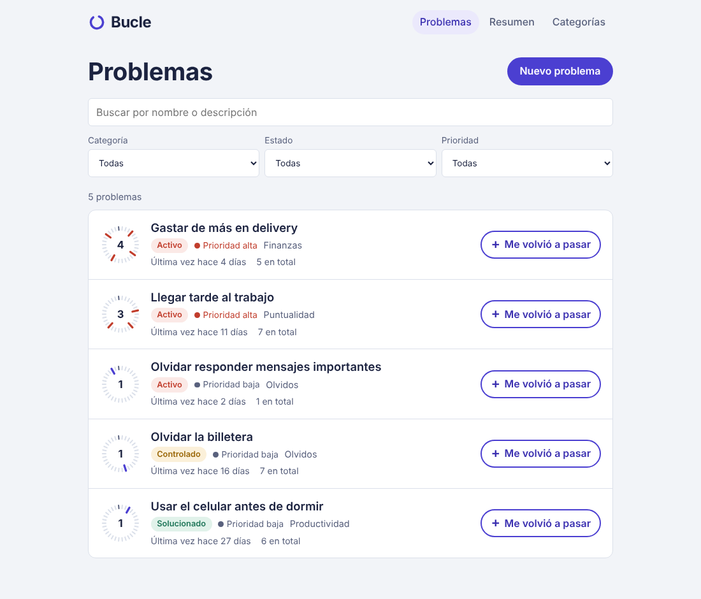
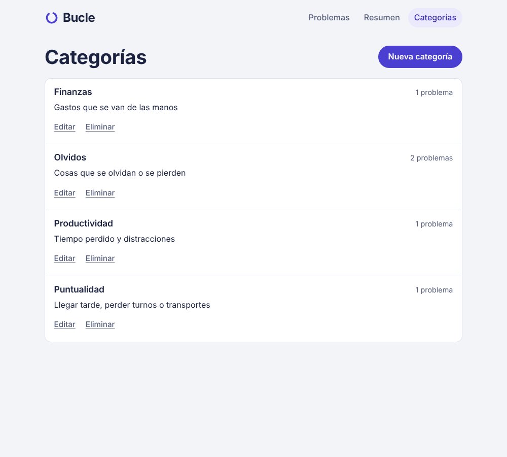
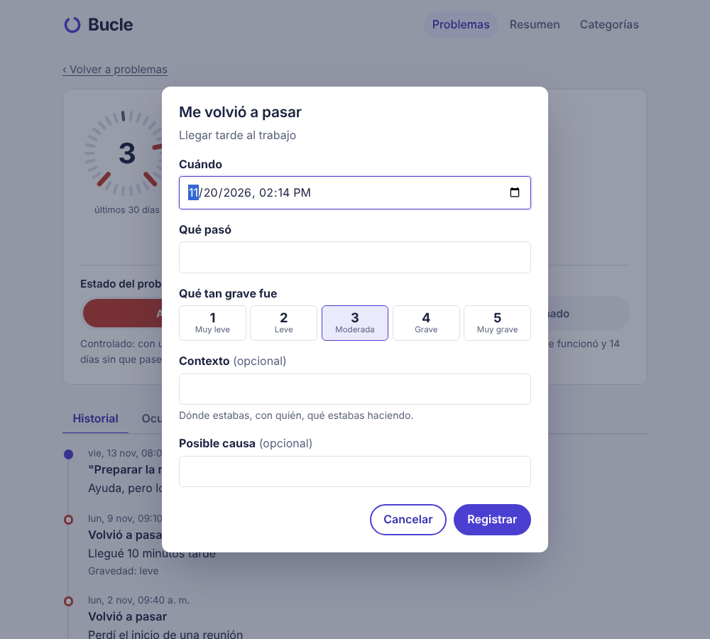
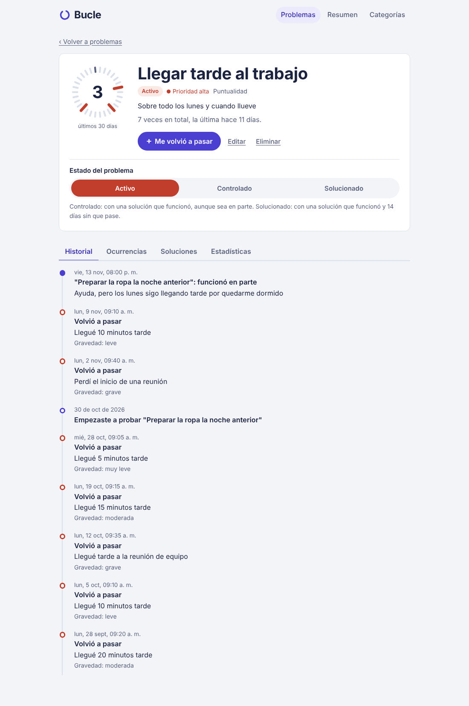
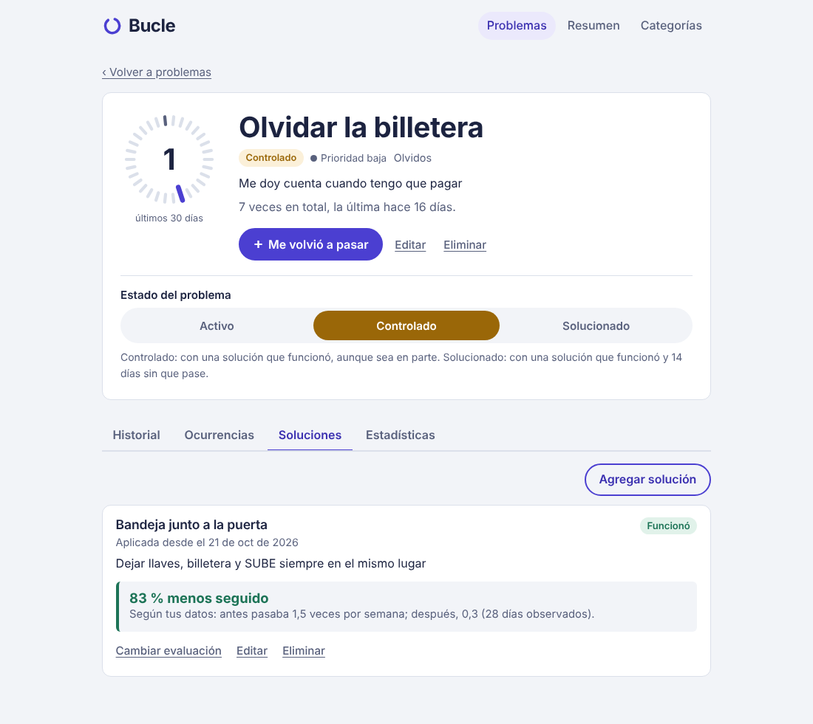
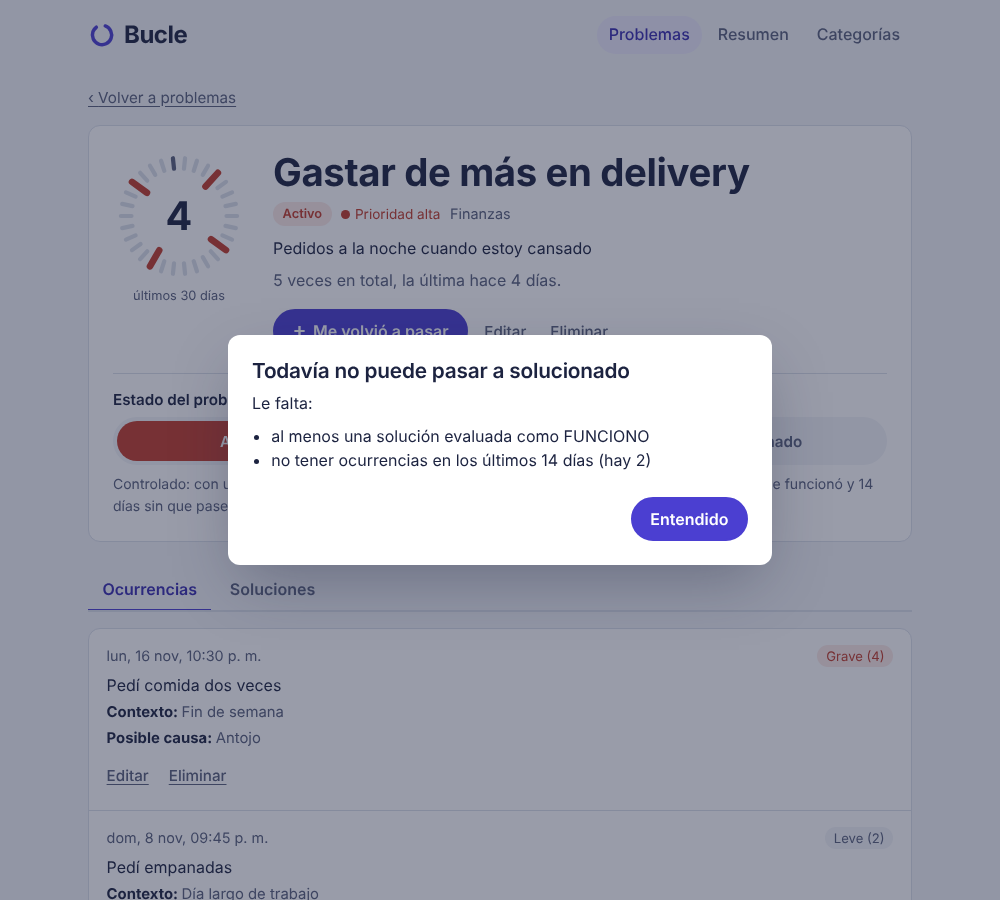
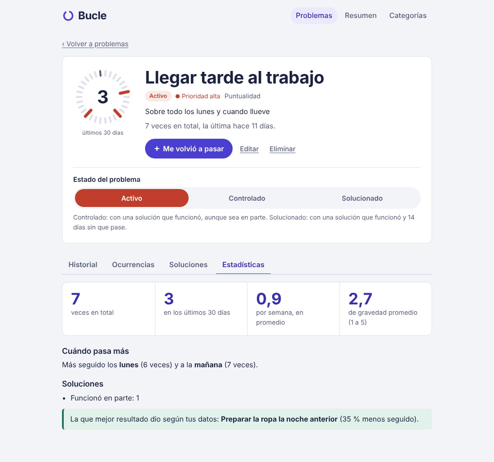
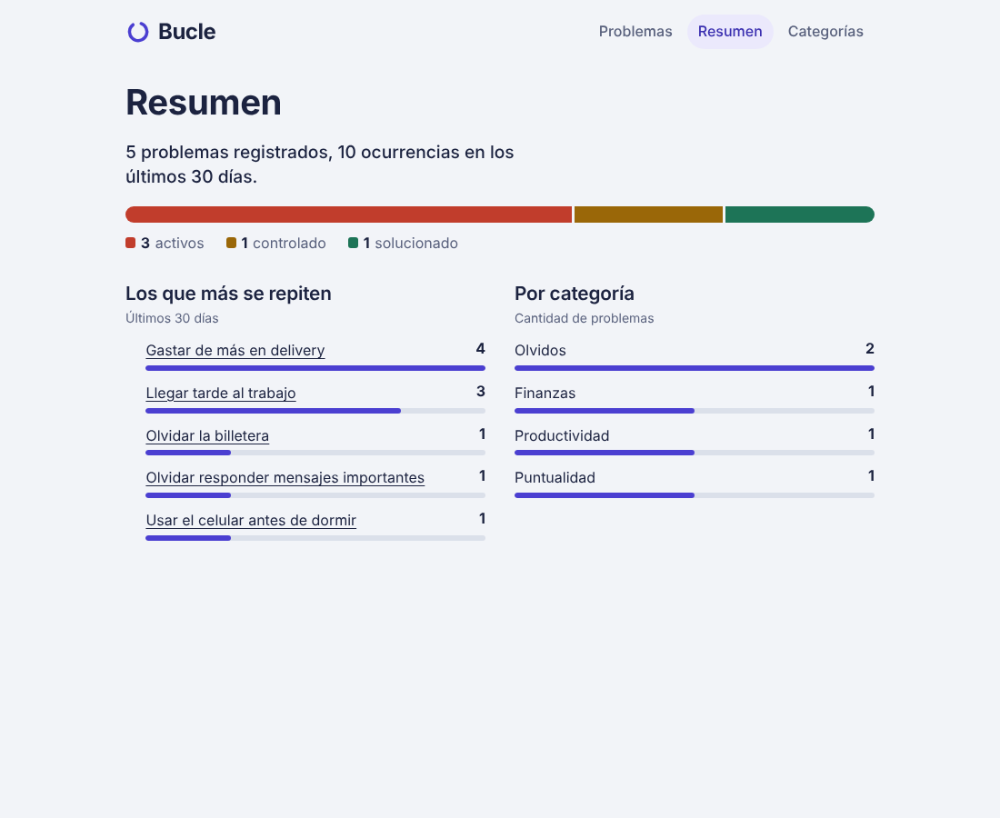

# Manual de usuario — Bucle

Este manual explica cómo usar Bucle paso a paso. No hace falta saber de tecnología: solo un navegador, en la computadora o en el celular.

**Dirección de la aplicación:** https://erroresapp.netlify.app

## Índice

1. [Qué es Bucle](#1-qué-es-bucle)
2. [Cómo entrar](#2-cómo-entrar)
3. [Conceptos básicos](#3-conceptos-básicos)
4. [La pantalla principal](#4-la-pantalla-principal)
5. [Crear una categoría](#5-crear-una-categoría)
6. [Crear un problema](#6-crear-un-problema)
7. [Registrar que volvió a pasar](#7-registrar-que-volvió-a-pasar)
8. [El detalle de un problema](#8-el-detalle-de-un-problema)
9. [Soluciones: agregar, evaluar y ver si funcionan](#9-soluciones-agregar-evaluar-y-ver-si-funcionan)
10. [Cambiar el estado de un problema](#10-cambiar-el-estado-de-un-problema)
11. [Historial y estadísticas](#11-historial-y-estadísticas)
12. [Buscar y filtrar](#12-buscar-y-filtrar)
13. [Resumen general](#13-resumen-general)
14. [Editar y eliminar](#14-editar-y-eliminar)
15. [Mensajes frecuentes y qué hacer](#15-mensajes-frecuentes-y-qué-hacer)
16. [Preguntas frecuentes](#16-preguntas-frecuentes)

---

## 1. Qué es Bucle

Bucle sirve para registrar los problemas que te pasan una y otra vez (llegar tarde, olvidarte algo, gastar de más), anotar cada vez que vuelven a pasar y probar soluciones. Con esos datos, la aplicación te muestra:

- Qué problemas son más frecuentes o más graves.
- Qué día de la semana y en qué momento del día te pasan más.
- Si una solución realmente redujo cuántas veces te pasa.

## 2. Cómo entrar

1. Abrí https://erroresapp.netlify.app en cualquier navegador (Chrome, Firefox, Edge, Safari).
2. No hace falta usuario ni contraseña.
3. Si aparece arriba el mensaje **"Conectando con el servidor… la primera carga puede tardar hasta un minuto"**, esperá: el servidor estaba en reposo y se está despertando. Después funciona rápido.

En el celular podés agregarla a la pantalla de inicio desde el menú del navegador ("Agregar a pantalla de inicio") para abrirla como una app.

## 3. Conceptos básicos

| Concepto | Qué es | Ejemplo |
|---|---|---|
| **Categoría** | Un grupo de problemas. | Puntualidad, Finanzas, Olvidos |
| **Problema** | Algo que te pasa seguido. | "Llegar tarde al trabajo" |
| **Ocurrencia** | Cada vez que el problema vuelve a pasar. | "El lunes llegué 15 minutos tarde" |
| **Solución** | Algo que probás para que deje de pasar. | "Poner la alarma 20 minutos antes" |
| **Estado** | Cómo está el problema: Activo, Controlado o Solucionado. | |
| **Prioridad** | Alta, Media o Baja. La calcula la aplicación según cuántas veces pasó en los últimos 30 días y qué tan grave fue. | |

## 4. La pantalla principal

La pantalla **Problemas** muestra todos tus problemas, con los más urgentes primero. Cada fila tiene:

- **El anillo de 30 días** (a la izquierda): cada marca es un día del último mes. Las marcas resaltadas son los días en que pasó el problema; el color indica la prioridad (rojo = alta, ámbar = media, violeta = baja). El número del centro es cuántas veces pasó en esos 30 días.
- **El nombre**: tocalo para ver el detalle.
- **El estado, la prioridad y la categoría.**
- **Cuándo pasó la última vez** y cuántas veces en total.
- **El botón "Me volvió a pasar"**, para registrar una ocurrencia sin entrar al detalle.

Arriba está el menú con las tres secciones: **Problemas**, **Resumen** y **Categorías**.

## 5. Crear una categoría

1. En el menú, tocá **Categorías**.
2. Tocá **Nueva categoría**.
3. Escribí el nombre (entre 2 y 40 caracteres) y, si querés, una descripción.
4. Tocá **Crear categoría**.

No puede haber dos categorías con el mismo nombre: "Finanzas" y "FINANZAS" se consideran iguales.

> Si creás un problema sin tener categorías, la aplicación te ofrece crear una primero.

## 6. Crear un problema

1. En **Problemas**, tocá **Nuevo problema**.
2. Completá:
   - **Qué te pasa** (obligatorio, entre 3 y 80 caracteres). Ejemplo: "Llegar tarde al trabajo".
   - **Categoría** (obligatoria).
   - **Descripción** (opcional): más detalles.
3. Tocá **Crear problema**. Se abre su detalle.

Todo problema nuevo empieza en estado **Activo** y con prioridad **Baja**.

## 7. Registrar que volvió a pasar

Es la acción más importante: conviene hacerla en el momento en que pasa, desde el celular.

1. Tocá **Me volvió a pasar** (en la fila del problema o en su detalle).
2. **Cuándo** ya trae la fecha y hora actuales. Si lo anotás más tarde, cambiala; no puede ser una fecha futura.
3. **Qué pasó** (obligatorio): una frase corta.
4. **Qué tan grave fue**: de 1 (muy leve) a 5 (muy grave).
5. **Contexto** y **Posible causa** (opcionales): ayudan a encontrar patrones.
6. Tocá **Registrar**.

La cantidad, la última vez, la prioridad y el anillo se actualizan solos.

> **Recaída:** si el problema estaba **Solucionado** y vuelve a pasar, la aplicación lo pasa automáticamente a **Activo** y te avisa. Si cargás una ocurrencia vieja (de antes de marcarlo como solucionado), el estado no cambia.

## 8. El detalle de un problema

Arriba ves el anillo grande, el nombre, el estado, la prioridad, la descripción y un resumen ("7 veces en total, la última hace 3 días"). Debajo:

- **Me volvió a pasar**, **Editar** y **Eliminar**.
- **Estado del problema**: tres opciones para cambiarlo (ver sección 10).
- **Pestañas:** Historial, Ocurrencias, Soluciones y Estadísticas.

## 9. Soluciones: agregar, evaluar y ver si funcionan

### Agregar una solución
1. En el detalle, abrí la pestaña **Soluciones** y tocá **Agregar solución**.
2. Completá **Qué vas a probar** (obligatorio), **Desde cuándo** (puede ser una fecha futura si la estás planificando) y una descripción opcional.
3. Tocá **Agregar solución**. Queda como **Sin evaluar**.

### Evaluarla
Cuando ya la probaste un tiempo:
1. Tocá **Evaluar** debajo de la solución.
2. Elegí **Funcionó**, **Funcionó en parte** o **No funcionó**.
3. Si no funcionó o funcionó en parte, **contá qué falló** en Observaciones (al menos 10 caracteres). Sirve para no repetir errores.
4. Tocá **Guardar evaluación**.

No se puede evaluar una solución cuya fecha de aplicación todavía no llegó.

### Qué dicen los datos
Debajo de cada solución, Bucle compara cuántas veces por semana pasaba el problema en las **4 semanas anteriores** a la solución y **después** de aplicarla:

| Mensaje | Qué significa |
|---|---|
| **"75 % menos seguido"** (verde) | Desde que aplicaste la solución, el problema pasa bastante menos. |
| **"50 % más seguido"** (rojo) | Pasa más que antes: la solución no está ayudando. |
| **"En observación"** | Pasaron menos de 7 días; todavía no hay datos suficientes para comparar. |
| **"No hay ocurrencias en las 4 semanas anteriores…"** | No se puede comparar porque no registraste ocurrencias antes de la solución. |

Esta comparación se muestra **al lado** de tu evaluación: así podés ver si tu impresión coincide con los datos.

## 10. Cambiar el estado de un problema

En el detalle, en **Estado del problema**, tocá el estado que quieras:

| Estado | Cuándo se puede elegir |
|---|---|
| **Activo** | Siempre. |
| **Controlado** | Cuando tiene al menos una solución evaluada como "Funcionó" o "Funcionó en parte". |
| **Solucionado** | Cuando tiene al menos una solución que "Funcionó" **y** no pasó en los últimos 14 días. |

Si falta alguna condición, aparece un mensaje que dice exactamente qué falta.

Cada cambio de estado queda registrado en el historial.

## 11. Historial y estadísticas

**Historial:** una línea de tiempo, de lo más reciente a lo más antiguo, con cada vez que pasó, cada solución que empezaste a probar, cada evaluación y cada cambio de estado (incluidas las recaídas).

**Estadísticas:**

- Veces en total y en los últimos 30 días.
- Promedio por semana.
- Gravedad promedio (de 1 a 5).
- **Cuándo pasa más:** el día de la semana y el momento del día (mañana de 6 a 12 h, tarde de 12 a 19 h, noche de 19 a 6 h).
- Cuántas soluciones hay de cada resultado y cuál dio mejor resultado según los datos.

## 12. Buscar y filtrar

En la pantalla **Problemas**:

- **Buscar:** escribí al menos 2 letras. Busca en el nombre y la descripción, sin importar mayúsculas ni acentos ("cafe" encuentra "café").
- **Filtros:** Categoría, Estado y Prioridad. Se pueden combinar entre sí y con la búsqueda.
- Si no hay resultados, tocá **Limpiar filtros** para ver todo de nuevo.

Los filtros se mantienen mientras navegás por la aplicación.

## 13. Resumen general

En el menú, **Resumen** muestra:

- Cuántos problemas tenés y cuántas veces pasaron en los últimos 30 días.
- Una barra con la proporción de problemas activos, controlados y solucionados.
- **Los que más se repiten** en los últimos 30 días.
- Cuántos problemas hay en cada categoría.

## 14. Editar y eliminar

| Qué | Dónde | Notas |
|---|---|---|
| Problema | Detalle → **Editar** / **Eliminar** | Si tiene registros, al eliminarlo se pide una segunda confirmación que dice cuántas ocurrencias, soluciones y cambios de estado se van a borrar. **No se puede deshacer.** |
| Ocurrencia | Pestaña Ocurrencias → **Editar** / **Eliminar** | Si el problema está Solucionado y cambiás la fecha de una ocurrencia a después de haberlo marcado así, cuenta como recaída. |
| Solución | Pestaña Soluciones → **Editar** / **Eliminar** | No se puede eliminar ni reevaluar la única solución que justifica que el problema esté Controlado o Solucionado, si con eso deja de justificarlo: primero cambiá el estado. |
| Categoría | Categorías → **Editar** / **Eliminar** | No se puede eliminar si tiene problemas: pasalos a otra categoría o eliminalos primero. |

## 15. Mensajes frecuentes y qué hacer

| Mensaje | Qué hacer |
|---|---|
| "Conectando con el servidor…" | Esperá hasta un minuto: el servidor se está despertando. |
| "No se pudo conectar con el servidor. Revisá tu conexión…" | Revisá tu conexión a internet y tocá **Reintentar**. |
| "Ya existe un problema llamado…" | Elegí otro nombre o buscá el problema existente. |
| "El campo … debe tener entre 3 y 80 caracteres" | Ajustá el largo del texto. |
| "La fecha de la ocurrencia no puede ser futura" | Revisá el campo **Cuándo**. |
| "Si la solución no funcionó o funcionó parcialmente, contá qué falló…" | Completá Observaciones con al menos 10 caracteres. |
| "Todavía no puede pasar a solucionado. Le falta: …" | Cumplí las condiciones que lista el mensaje (sección 10). |
| "Esta categoría está en uso" | Mové o eliminá sus problemas antes de borrarla. |
| "La búsqueda debe tener al menos 2 caracteres" | Escribí una letra más. |

## 16. Preguntas frecuentes

**¿Mis datos se guardan?**
Sí, en una base de datos en internet. Podés cerrar el navegador y seguir otro día, desde cualquier dispositivo.

**¿Otras personas pueden ver mis datos?**
Esta versión es para un solo usuario y no tiene inicio de sesión: cualquiera que tenga la dirección puede ver y modificar los datos. No guardes información privada o sensible.

**¿Por qué la prioridad cambió sola?**
Porque se calcula con las ocurrencias de los últimos 30 días: 0 o 1 → Baja; 2 a 4 → Media; 5 o más → Alta. Si alguna fue grave (4 o 5), sube un nivel. Con el paso del tiempo, las ocurrencias viejas dejan de contar.

**¿Puedo anotar algo que pasó hace días?**
Sí: al registrar la ocurrencia, cambiá la fecha y hora en **Cuándo**.

**¿Qué diferencia hay entre mi evaluación y el porcentaje de los datos?**
La evaluación es tu opinión; el porcentaje sale de comparar cuántas veces pasó antes y después. Se muestran juntos para que puedas contrastarlos.
