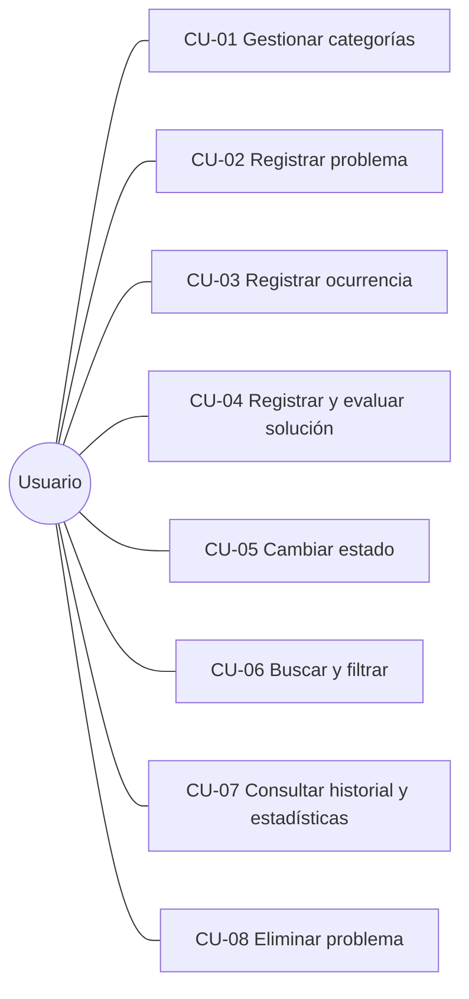
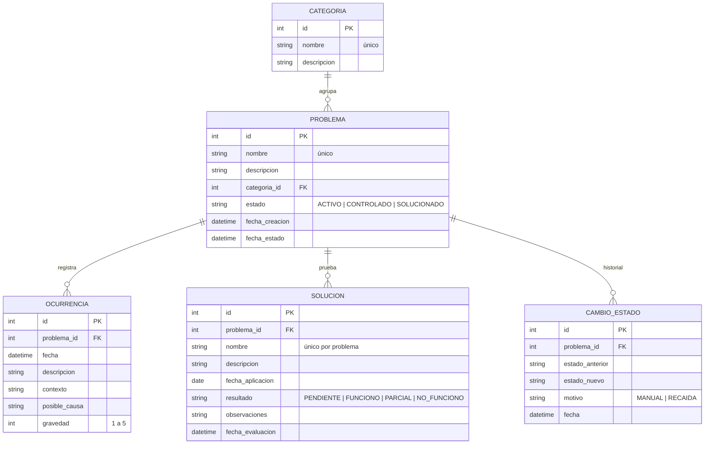
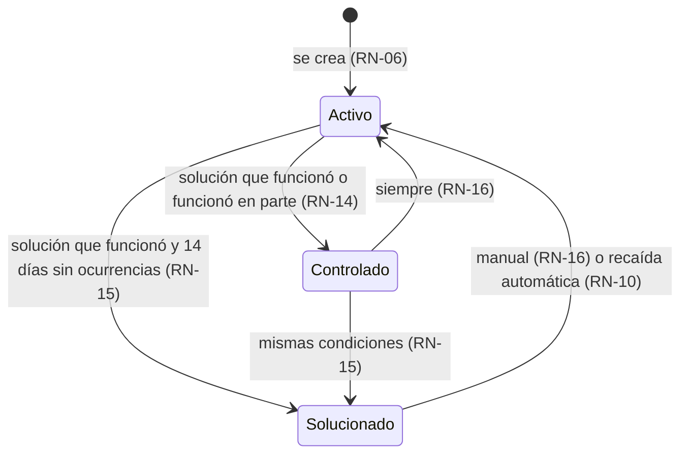
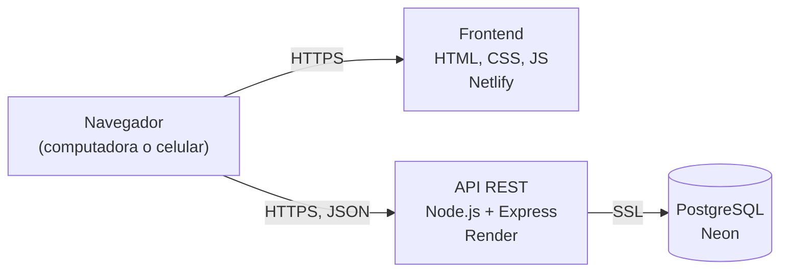

# Relevamiento del proyecto — Bucle

Documento de relevamiento y análisis del sistema **Bucle**. Reúne el contexto del problema, los usuarios, los requerimientos, los casos de uso, el modelo de datos, la arquitectura, los riesgos y la factibilidad del proyecto.

| | |
|---|---|
| Proyecto | Bucle — registro y seguimiento de problemas recurrentes |
| Programa | Generación T — proyecto final propio |
| Repositorio | https://github.com/FacuScardaoni/bucle |
| Aplicación publicada | https://erroresapp.netlify.app |
| Versión del documento | 1.0 — noviembre de 2026 |

Documentos relacionados: [Especificación (SPEC)](SPEC.md) · [Plan de desarrollo](PLAN.md) · [Informe de pruebas](INFORME_PRUEBAS.md) · [Manual de usuario](MANUAL_USUARIO.md) · [Manual técnico](MANUAL_TECNICO.md)

---

## 1. Contexto y situación actual

Muchas personas tienen problemas que se repiten en su vida cotidiana: llegar tarde, olvidarse cosas, gastar más de lo previsto, perder tiempo con el celular o cometer siempre el mismo error en el trabajo o el estudio.

Hoy, la forma habitual de manejarlos es informal:

- **Memoria y sensación:** la persona "siente" que algo le pasa seguido, pero no sabe cuántas veces, desde cuándo ni en qué circunstancias.
- **Notas sueltas:** anotaciones en el celular o en papel, sin estructura ni fechas comparables.
- **Planillas de cálculo:** sirven para registrar, pero hay que armarlas, mantenerlas y calcular todo a mano.
- **Aplicaciones de hábitos:** están pensadas para sumar hábitos buenos (rachas, recordatorios), no para analizar un problema, sus causas y las soluciones que se probaron.

En todos los casos falta lo mismo: **relacionar cada vez que el problema ocurre con las soluciones que se intentaron**, para saber con datos si una solución realmente funcionó.

## 2. Problema detectado

> Las personas no registran cuándo ocurren sus problemas recurrentes ni qué hicieron para solucionarlos. Por eso no pueden descubrir patrones ni comprobar si las soluciones que prueban funcionan.

Consecuencias:

1. Se repiten soluciones que no funcionan, o se abandonan soluciones que sí funcionaban.
2. No se detectan patrones (por ejemplo, "me pasa los lunes a la mañana").
3. Es difícil priorizar: no se sabe qué problema es más frecuente o más grave.
4. La evaluación de una solución depende solo de la percepción personal.

## 3. Método de relevamiento

Al ser un proyecto propio, el relevamiento se hizo a partir del análisis del dominio y no de un cliente externo:

| Técnica | Qué se hizo | Resultado |
|---|---|---|
| Análisis del problema | Se describieron situaciones reales de la vida cotidiana (puntualidad, olvidos, gastos, distracciones) y qué información haría falta para entenderlas. | Entidades del sistema: problema, ocurrencia, solución, categoría. |
| Revisión de alternativas | Se compararon las formas actuales de registrar estos problemas (sección 1). | Diferencial de Bucle: la comparación antes/después de cada solución. |
| Escenarios de uso | Se escribieron recorridos completos (por ejemplo: "llego tarde, lo anoto en el momento, pruebo poner la alarma antes y a las semanas veo si sirvió"). | Casos de uso (sección 9) y botón rápido "Me volvió a pasar". |
| Definición de reglas | Cada escenario se tradujo en reglas verificables, con casos límite (13 o 14 días, 4 o 5 ocurrencias). | 22 reglas de negocio numeradas (sección 8). |
| Validación con prototipo | Se probó la aplicación con datos de demostración realistas y se ajustó lo que no se entendía o no se veía bien. | Ajustes registrados en el [informe de pruebas](INFORME_PRUEBAS.md). |

## 4. Usuarios e interesados

| Perfil | Necesidad principal | Uso típico |
|---|---|---|
| **Estudiante** | Organizarse mejor: llegar a horario, no olvidar entregas, estudiar sin distracciones. | Registra desde el celular en el momento en que pasa algo. |
| **Trabajador/a** | Reducir errores repetidos y problemas de puntualidad o gastos. | Revisa estadísticas y efectividad de soluciones una vez por semana. |
| **Cualquier persona** | Entender por qué algo le pasa una y otra vez. | Usa las categorías para separar áreas de su vida. |

Interesados en el proyecto: el **usuario final** (única persona que usa su instancia en la versión 1), el **desarrollador** y los **docentes evaluadores** de Generación T.

## 5. Objetivos

**Objetivo general:** desarrollar una aplicación web que permita registrar problemas recurrentes, sus ocurrencias y las soluciones probadas, y que muestre con datos cuáles soluciones funcionan.

**Objetivos específicos:**

1. Registrar problemas organizados por categorías.
2. Registrar cada ocurrencia con fecha, contexto, posible causa y gravedad en pocos segundos.
3. Documentar soluciones y evaluarlas.
4. Calcular automáticamente la prioridad de cada problema según su frecuencia y gravedad.
5. Medir la efectividad de cada solución comparando la frecuencia antes y después de aplicarla.
6. Mostrar patrones (día y momento del día en que más ocurre) e historial.
7. Publicar la aplicación en internet con frontend, backend y base de datos.

## 6. Alcance

| Incluye (versión 1) | No incluye |
|---|---|
| Alta, consulta, edición y baja de categorías, problemas, ocurrencias y soluciones | Múltiples usuarios e inicio de sesión |
| Ciclo de estados con condiciones (Activo, Controlado, Solucionado) | Inteligencia artificial o recomendaciones automáticas |
| Prioridad calculada | Notificaciones o recordatorios |
| Búsqueda y filtros combinables | Aplicación móvil nativa |
| Historial, estadísticas y efectividad de soluciones | Exportación de datos |
| Interfaz web adaptable a celular | Modo sin conexión |

## 7. Requerimientos

### 7.1 Requerimientos funcionales

| ID | Requerimiento | Funcionalidad (SPEC) |
|---|---|---|
| RF-01 | El sistema debe permitir crear, listar, editar y eliminar categorías. | F-01 |
| RF-02 | El sistema debe permitir crear un problema con nombre, descripción y categoría. | F-02 |
| RF-03 | El sistema debe permitir editar y eliminar problemas. | F-03 |
| RF-04 | El sistema debe permitir registrar, editar y eliminar ocurrencias, con un acceso rápido desde el listado. | F-04 |
| RF-05 | El sistema debe permitir registrar, editar y eliminar soluciones. | F-05 |
| RF-06 | El sistema debe permitir evaluar una solución como "funcionó", "funcionó en parte" o "no funcionó". | F-06 |
| RF-07 | El sistema debe permitir cambiar el estado de un problema respetando sus condiciones. | F-07 |
| RF-08 | El sistema debe permitir buscar problemas por texto y filtrarlos por categoría, estado y prioridad. | F-08 |
| RF-09 | El sistema debe mostrar el historial cronológico de cada problema. | F-09 |
| RF-10 | El sistema debe mostrar estadísticas por problema, la efectividad de cada solución y un resumen general. | F-10 |
| RF-11 | El sistema debe validar los datos y mostrar mensajes de error claros junto al campo con problemas. | RN-01 y sección 5 de la SPEC |

### 7.2 Requerimientos no funcionales

| ID | Categoría | Requerimiento | Cómo se cumple |
|---|---|---|---|
| RNF-01 | Usabilidad | Registrar una ocurrencia debe llevar pocos segundos. | Botón "Me volvió a pasar" con fecha y hora ya cargadas. |
| RNF-02 | Usabilidad | La interfaz debe poder usarse en celular. | Diseño adaptable probado a 390 px de ancho. |
| RNF-03 | Accesibilidad | Debe poder usarse con teclado y lectores de pantalla. | Etiquetas en todos los campos, foco visible, textos alternativos, respeto de "reducir movimiento". |
| RNF-04 | Disponibilidad | La aplicación debe estar publicada en internet. | Netlify (frontend), Render (backend), Neon (base). |
| RNF-05 | Rendimiento | Las pantallas deben responder en menos de 2 segundos con el servidor activo. | Pocas consultas por pantalla y cálculos en memoria (un solo usuario). |
| RNF-06 | Seguridad | No debe haber credenciales en el repositorio. | Variables de entorno; `.env` ignorado; historial revisado. |
| RNF-07 | Seguridad | Los textos del usuario no deben poder inyectar código. | El frontend nunca inserta texto como HTML. |
| RNF-08 | Seguridad | La conexión con la base debe estar cifrada. | SSL obligatorio con Neon. |
| RNF-09 | Integridad | Los datos no deben quedar inconsistentes. | Reglas RN-07, RN-17 y RN-18; transacciones; claves foráneas. |
| RNF-10 | Mantenibilidad | El código debe ser modular y estar probado. | Arquitectura en capas; 109 tests + 14 contra PostgreSQL. |
| RNF-11 | Portabilidad | No debe depender de un proveedor específico. | PostgreSQL estándar y Node.js; el frontend es HTML estático. |
| RNF-12 | Costo | El proyecto debe poder publicarse sin costo. | Planes gratuitos de Netlify, Render y Neon. |

## 8. Reglas de negocio

Las 22 reglas están detalladas en la [SPEC](SPEC.md#5-reglas-de-negocio). Resumen:

| Grupo | Reglas | Idea principal |
|---|---|---|
| Generales | RN-01 | Textos recortados y validados; errores claros. |
| Categorías | RN-02, RN-03 | Nombre único; no se borra si tiene problemas. |
| Problemas | RN-04 a RN-08 | Nombre único, categoría obligatoria, valores iniciales, datos y prioridad calculados. |
| Ocurrencias | RN-09, RN-10 | Fecha no futura, gravedad 1 a 5; recaída automática. |
| Soluciones | RN-11 a RN-13 | Nace pendiente; evaluación con condiciones. |
| Estados | RN-14 a RN-17 | Requisitos para Controlado y Solucionado; consistencia. |
| Eliminación | RN-18 | Confirmación y borrado en cascada. |
| Búsqueda | RN-19 | Filtros combinables y orden por prioridad. |
| Estadísticas | RN-20 a RN-22 | Efectividad antes/después, estadísticas e historial. |

## 9. Casos de uso

Actor único: **Usuario**.

### CU-01 Gestionar categorías
- **Precondición:** ninguna.
- **Flujo principal:** el usuario entra a "Categorías", toca "Nueva categoría", escribe el nombre y guarda. La categoría aparece en la lista.
- **Alternativos:** nombre repetido → el sistema lo rechaza junto al campo (RN-02). Eliminar una categoría con problemas → el sistema explica que está en uso (RN-03).

### CU-02 Registrar problema
- **Precondición:** existe al menos una categoría (si no, el sistema ofrece crearla primero).
- **Flujo principal:** el usuario toca "Nuevo problema", completa qué le pasa, elige la categoría y guarda. El sistema crea el problema en estado Activo y abre su detalle.
- **Alternativos:** nombre de menos de 3 caracteres o repetido → error junto al campo (RN-04).

### CU-03 Registrar ocurrencia
- **Precondición:** existe el problema.
- **Flujo principal:** el usuario toca "Me volvió a pasar" (en el listado o en el detalle). La fecha y hora actuales ya están cargadas; escribe qué pasó, elige la gravedad y guarda. El sistema actualiza la cantidad, la última vez, la prioridad y el anillo de 30 días.
- **Alternativos:** fecha futura o gravedad inválida → error (RN-09). Si el problema estaba Solucionado → vuelve a Activo y se avisa que es una recaída (RN-10).

### CU-04 Registrar y evaluar solución
- **Precondición:** existe el problema.
- **Flujo principal:** en la pestaña "Soluciones", el usuario agrega qué va a probar y desde cuándo. Más adelante toca "Evaluar" y elige el resultado. El sistema muestra, junto a la evaluación, la comparación de frecuencia antes y después según los datos (RN-20).
- **Alternativos:** evaluar antes de la fecha de aplicación → error (RN-13). "No funcionó" o "Funcionó en parte" sin observaciones → error (RN-13).

### CU-05 Cambiar estado
- **Flujo principal:** el usuario elige Activo, Controlado o Solucionado en el detalle. Si se cumplen las condiciones, el estado cambia y queda en el historial.
- **Alternativos:** si falta alguna condición, el sistema la explica en un mensaje (RN-14, RN-15).

### CU-06 Buscar y filtrar
- **Flujo principal:** el usuario escribe en el buscador o elige filtros. El listado se actualiza ordenado por prioridad.
- **Alternativos:** sin resultados → mensaje y botón "Limpiar filtros".

### CU-07 Consultar historial y estadísticas
- **Flujo principal:** en el detalle, el usuario abre "Historial" o "Estadísticas"; en el menú, "Resumen" muestra la vista general.

### CU-08 Eliminar problema
- **Flujo principal:** el usuario toca "Eliminar" y confirma. Si el problema tiene registros, el sistema pide una segunda confirmación indicando cuántos se van a borrar (RN-18).

## 10. Modelo de datos

Valores calculados (no se guardan, para que nunca queden desactualizados): cantidad de ocurrencias, fecha de la última ocurrencia, prioridad, actividad de los últimos 30 días, estadísticas y efectividad.

## 11. Ciclo de estados de un problema

## 12. Arquitectura

Dentro del backend, el código se organiza en capas: **rutas** (HTTP) → **servicios** (casos de uso) → **dominio** (reglas de negocio puras) y **repositorios** (acceso a datos). Detalle en el [manual técnico](MANUAL_TECNICO.md).

## 13. Restricciones y supuestos

- **Restricciones de la consigna:** repositorio público, frontend completo, backend y base de datos publicados, informe de pruebas y plan dentro del repositorio, un commit por tarea.
- **Tecnológicas:** uso de planes gratuitos (el servidor de Render se "duerme" sin uso).
- **Supuestos:** un único usuario por instalación; uso en la zona horaria de Argentina; volumen de datos bajo (cientos de registros).

## 14. Riesgos

| Riesgo | Probabilidad | Impacto | Mitigación |
|---|---|---|---|
| Demora de la primera carga por el plan gratuito de Render | Alta | Medio | Aviso "Conectando con el servidor…" y llamada a `/api/salud` al abrir la app. |
| Pérdida de datos en la base | Baja | Alto | Neon permite restaurar la base a un momento anterior dentro de su período de retención; los datos de demostración se pueden recargar con `seed.sql`. |
| Exposición de credenciales | Baja | Alto | Variables de entorno, `.env` ignorado, revisión del historial. |
| Datos inconsistentes (estado sin soluciones que lo justifiquen) | Media | Medio | Reglas RN-17 y RN-18 con tests. |
| Acceso de terceros (no hay inicio de sesión) | Media | Medio | Limitación conocida y documentada de la versión 1. |
| Cambios en los servicios gratuitos | Media | Medio | Tecnologías estándar, fáciles de mover a otro proveedor. |

## 15. Factibilidad

- **Técnica:** factible. Se usan tecnologías maduras y documentadas (Node.js, Express, PostgreSQL, HTML/CSS/JS), sin dependencias complejas.
- **Económica:** costo cero para publicar, gracias a los planes gratuitos de Netlify, Render y Neon. El único recurso es el tiempo de desarrollo.
- **Operativa:** factible. El usuario solo necesita un navegador; no requiere instalación ni capacitación especial (ver [manual de usuario](MANUAL_USUARIO.md)).

## 16. Planificación

El desarrollo se dividió en 24 tareas, una por commit, registradas en el [plan](PLAN.md):

| Etapa | Tareas |
|---|---|
| Base del proyecto y documentación | T-01 |
| Backend y reglas de negocio | T-02 a T-15 |
| Publicación del backend y la base | T-16 |
| Frontend | T-17 a T-19 |
| Publicación del frontend | T-20 |
| Pruebas en producción e informe | T-21 |
| Relevamiento y manuales | T-22 a T-24 |

## 17. Glosario

| Término | Significado |
|---|---|
| **Problema** | Situación que le pasa al usuario de forma repetida. |
| **Ocurrencia** | Cada vez que el problema vuelve a pasar. |
| **Solución** | Algo que el usuario prueba para que el problema deje de pasar. |
| **Categoría** | Grupo de problemas (por ejemplo, "Finanzas"). |
| **Prioridad** | Nivel de atención calculado según las ocurrencias de los últimos 30 días y su gravedad. |
| **Recaída** | Ocurrencia de un problema que estaba marcado como solucionado. |
| **Efectividad** | Comparación de la frecuencia semanal antes y después de aplicar una solución. |
| **API** | Servicio que recibe los pedidos del frontend y trabaja con la base de datos. |
| **Frontend** | La parte de la aplicación que se ve en el navegador. |
| **Backend** | La parte que corre en el servidor y aplica las reglas de negocio. |
